И снова здрассссь!))

Когда я закончил 10 проект, начал сдавать и подписался на 11й, то я понял, что 11й я совершенно случайно сделал в 10м.\
Поентому тут в репорте будет в основном копипаста с 10го.

Но, чтобы не было обвинений, что я какие-то пункты из задания не сделал, то мы отдельно развернем кластер k3s, запустим там ингресс и cert-manager.\
Однако, да простится мне енто, работа будет сделана на моем k8s кластере, а в качестве прокси идет envoy, а ингресс контроллером к нему - contour.

Просто не хочу сейчас дергать работающую систему - все настроено, dns работает, dst-nat с роутера проброшен.

## Развертывание k3s

Ничего сложного, почти как докер сворм. Ребята из Ранчер вообще молодцы, и много чего полезного делают.

Установили бубунту на три машины. На первой инициируем кластер:

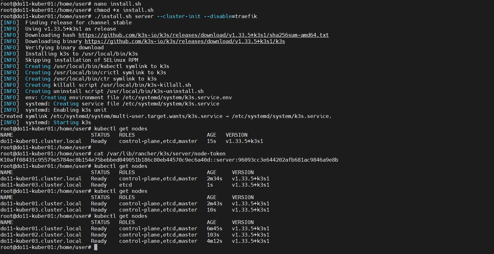

На других цепляем к кластеру при установке k3s:

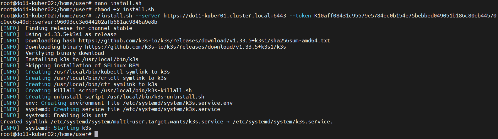

Кластер собрался, поглядим его описание:

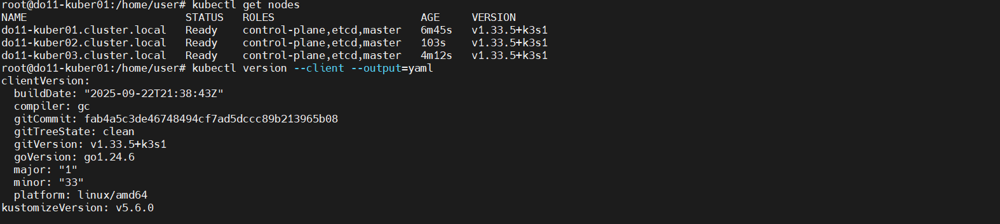

Смотрим неймспейсы. Среди них и cert-manager, и поднимающийся ингресс:

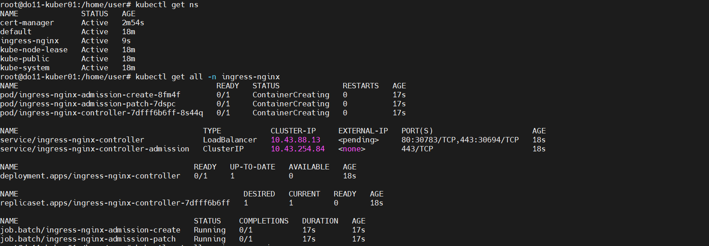

Тут, кстати, страничка на nginx ingress, если кому интересно https://docs.nginx.com/nginx-ingress-controller/installation/installing-nic/installation-with-manifests/. Я поставил через манифесты.

## Сервисы

Вот тут начинается, по сути, копипаста в 10го.

### Подготовка почвы

Первое, с чего начнем - Namespace (файл do10-part2-ns.yaml):
```
apiVersion: v1
kind: Namespace
metadata:
  name: do10-part2
  labels:
    name: do10-part2
    env: test
    owner: Stilwool
```

Далее. Я не пользуюсь открытым аккаунтом на DockerHub (свой Harbor). А значит, для логина на хоронилище надо подготовить специальный секрет.\
Вообще, секреты бывают разных типов. Подробнее читайте туть https://kubernetes.io/docs/concepts/configuration/secret/

По сути, нам надо сообщить докеру в формате JSON подобную информацию:
```
{
	"auths": {
        //Тут адрес нашего registry
		"docker.mcshine.ru": {
            //Тут строка имени и пароля в Base64
			"auth": "dGVzdDoxMjM0NTY3ODkwUVdFUlRZVUlPUGFzZGZnaGprbA=="
		}
	}
}
```

К примеру, для логина на докерхаб у нас пользователь test, а пароль 1234567890QWERTYUIOPasdfghjkl. Тогда мы вбиваем в терминале следующее:
```
//Ключ "-n" объязателен, нам не нужен зашифрованный символ переноса строки
user@Ubuntu-Desktop:~$ echo -n "test:1234567890QWERTYUIOPasdfghjkl" | base64 
dGVzdDoxMjM0NTY3ODkwUVdFUlRZVUlPUGFzZGZnaGprbA==
//Убедимся, что все ок
user@Ubuntu-Desktop:~$ echo "dGVzdDoxMjM0NTY3ODkwUVdFUlRZVUlPUGFzZGZnaGprbA==" | base64 -d
test:1234567890QWERTYUIOPasdfghjkluser@Ubuntu-Desktop:~$
```

Теперь JSON файл выше мы тоже прогоняем через Base64 и в итоге получаем искому строку.

Теперь запишем секрет:
```
apiVersion: v1
kind: Secret
metadata:
  //Вот енто имя и надо будет указывать
  name: regcred
  namespace: do10-part2
//Специальный тип секретов для докер конфигов
type: kubernetes.io/dockerconfigjson
data:
  .dockerconfigjson: >-
    <JSON docker auth as a Base64 string>
```

### В очередь

По идее, можно все написать в едином манифесте, но лучше под каждую сущность выделить отдельный файл, так как если надо будет грохнуть и что то переделать, то других сущностей енто не коснется.

А еще особняком будут стоять БД и Раббит.

Начнем с менеджера очереди, так как оно попроще.

Создадим конфиг rabbitmq-config.yaml:
```
apiVersion: v1
kind: ConfigMap
metadata:
  labels:
    //Вообще, чем больше меток, тем лучше таргетирование
    app: do10-part2-rabbit-app
  //Имя собственное
  name: do10-part2-rabbit-config
  //Принадлежность к неймспейсу
  namespace: do10-part2
data:
  //Самый простой способ - "название ключа: значение". Дальше будет веселее
  RABBITMQ_SERVER_ADDITIONAL_ERL_ARGS: "-rabbit disk_free_limit 2147483648"
```

Секрет rabbitmq-secrets.yaml:
```
apiVersion: v1
kind: Secret
metadata:
  labels:
    app: do10-part2-rabbit-app
  name: do10-part2-rabbit-secrets
  namespace: do10-part2
//Общий тип. Он же идет по умолчанию
type: Opaque
data:
  //Как в конфиге - "название ключа: значение"
  RABBITMQ_DEFAULT_USER: "dXNlcg=="
  RABBITMQ_DEFAULT_PASS: "TXlTdHJvbmdQYXNzd29yZEZvclJhYmJpdA=="
```

Сам сервис rabbitmq-statefulset.yaml:
```
apiVersion: apps/v1
//Вот туть внимание!!! Для приложений, которые имеют некоторые ожидаемые состояния,
//стоит использовать не деплоймент, а именно StatefulSet.
//В отличие от деплоймента все поды указанные в спецификации будут уникальными.
kind: StatefulSet
metadata:
  labels:
    app: do10-part2-rabbit-app
  name: do10-part2-rabbit-app
  namespace: do10-part2
spec:
  //Имя так называемого "headless сервиса" который не привязан к ClusterIP. 
  //Он обеспечивает DNS-записи для всех подов, соответствующих указанному селектору.
  serviceName: do10-part2-rabbit-headless-svc
  replicas: 1
  selector:
    matchLabels:
      app: do10-part2-rabbit-app
  template:
    metadata:
      labels:
        app: do10-part2-rabbit-app
    spec:
      //Спецификация подов
      containers:
      - name: do10-part2-rabbit-app
        image: rabbitmq:3-management-alpine
        env:
          //Имя переменной окружения в контейнере
          - name: RABBITMQ_SERVER_ADDITIONAL_ERL_ARGS
            valueFrom:
              //Берем из конфига
              configMapKeyRef:
                //Название конфига
                name: do10-part2-rabbit-config
                //Ключ в конфиге
                key: RABBITMQ_SERVER_ADDITIONAL_ERL_ARGS
          - name: RABBITMQ_DEFAULT_PASS
            valueFrom:
              //Берем значение из секрета
              secretKeyRef:
                //Название секрета
                name: do10-part2-rabbit-secrets
                //Ключ в секрете
                key: RABBITMQ_DEFAULT_PASS
          - name: RABBITMQ_DEFAULT_USER
            valueFrom:
              secretKeyRef:
                name: do10-part2-rabbit-secrets
                key: RABBITMQ_DEFAULT_USER
        ports:
          //Порт контейнера
          - containerPort: 5672
            name: rabbit
```

Как видно, можно спокойно перечислять все переменные окружения. И когда их 2-3 штуки, то и так нормально. А если 23? На ентот вопрос ответим ниже, когда дойдем до наших микросервисов.

Еще мы затронули некую сущность - headless сервис. Опишем её так rabbitmq-headless-svc.yaml:
```
apiVersion: v1
kind: Service
metadata:
  labels:
    app: do10-part2-rabbit-app
  name: do10-part2-rabbit-headless-svc
  namespace: do10-part2
spec:
  //Вот енто его и отличает от обычного сервиса
  clusterIP: None
  ports:
  - name: rabbimq
    port: 5672
    targetPort: rabbimq
    protocol: TCP 
  selector:
    app: do10-part2-rabbit-app
```

Посмотрим как он седет себя:

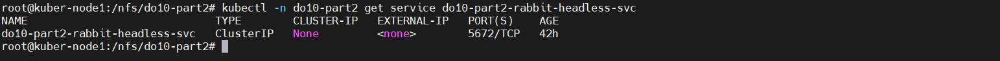

Как видим, у контейнера есть порт, но он никуда не прокинут, т.е. доступен внутри неймспейса. У него даже нет кластерного адреса.\
Как же к нему обратиться? Ответ - по внутрикластерному ДНС имени. Кубер держит внутреннюю ДНС таблицу. И когда мы используем простой деплоймент, то имя сервиса предугадать невозможно. А вот при StatefulSet мы его можем знать и использовать.

Для Раббита имя будет таким: do10-part2-rabbit-app-0.do10-part2-rabbit-headless-svc.do10-part2.svc. Или просто по имени сервиса do10-part2-rabbit-headless-svc.do10-part2.svc.

С раббитом закончили. Перейдем к более интересной штуке.

### База данных

Её тоже стоит делать в StatefulSet. Но более того, у БД есть данные, которые неплохо было бы срохонить, и сделать так, что они не пропали.

Мы помним с предыдущих проектов, что к контейнеру можно подключить папку с сервера. Такое же можно и туть.

В kubernetes оно называется Persistent Volume.

Теперь чуть внимания. Хотя, вполне осознаю, что далее у вас может, и вполне резонно, вырваться замечание, что втираю какую-то дичь.

Енто на самом деле какая-то дичь. Но давайте по порядку.

Во-первых, в kubernetes мы не можем, как просто в докере, напрямую подключить папку, ну, или PV. Тут нужна специальная прослойка - запрос на волюм (Persistent Volume Claim (PVC)). В ней мы указываем какой волюм хотим, а кубер сам подыскивает подходящий по размеру режиму чтения-записи и привязывает его на время к поду.

Вот тут могу напомнить, что большое количество правильно расставленных меток (labels) может сильно облегчить таргетирование.

Раз уж я вспомнил про режим чтения-записи, то их бывает три:
1. ReadWriteOnce (RWO): Volume может быть смонтирован для чтения и записи только одним узлом.
2. ReadOnlyMany (ROX): Volume может быть смонтирован только для чтения несколькими узлами.
3. ReadWriteMany (RWX): Volume может быть смонтирован для чтения и записи несколькими узлами

К примеру, в случае БД следует использовать первый вариант.

Теперь к дичи. Вот у нас есть папка на сервере, мы какой-то озбразой сделали из неё Persistent Volume и повесили БД. И сервер накрылся. Что будет с БД?

Оно подымется на другой ноде, и создаст локальную папку под Persistent Volume.

Вот над решением ентой задачи и стоит подумать, когда планируешь Кубер-кластер. Решение являет собой уравнение в которое включены надежность (отказоустойчивость), быстрота доступа к данным, стоимость и целесообразность.

В качестве организации Persistent Volume предлагаю вниманию следующий список:
1. local - Просто, работает шустро (со скоростью локального дискового агрегата), не тратится время на пересылку данных.
2. NFS - Сетевой файловый протокол. Можно подключить одну шару ко всем нодам кластера по одному пути, и можно быть уверенным, что под будет использовать одни и те же данные, где бы не поднялся. Плюсы - дешево, сердито, легко разворачивается, отлично подходит для небольшого кластера, где СХД с NFS напрямую (физически близко) подключено к кластеру. Минусы - время на сетевое общение (рекомендую почитать про сам NFS), на больших физических расстояниях работа затруднена, да, есть тоннели, но есть и задержка сети.
3. iscsi - Протокол сетевого блочного устройства. Можно как и NFS цеплять к нодам, но надо быть осторожным с определением разрешений чтения-записи, так как тут работа идет не с файловой структурой, а с блочным устройством.
4. fc. хмммм... Тут сложно что-то комментировать. SAN на FC - енто хорошо. По сути, похоже на iscsi, только возможности ширее, расстояния больше и скорости выше. Хотя, последнее более ощутимо с ростом расстояния, так как Ethernet на малых дистанциях сейчас даёт весьма приличные скорости.
5. cephfs и иже с ним. Тоже вариант.

Конкретно у меня используется NFS шара подключенная ко всем нодам кластера.

Но для еще более удобного устройства волюмов и запроса к ним, есть такая сущность - Storage Class. Представляет собой способ описания классов хранилища, которые можно использовать для динамического выделения PersistentVolumes (PV) при создании PersistentVolumeClaims (PVC).

Посмотрим на класс хоронилища для БД - postgres-storclass.yaml:
```
apiVersion: storage.k8s.io/v1
//Тип
kind: StorageClass
metadata:
  //Стандартно - имя, неймспейс
  name: do10-part2-postgres-storage-class
  namespace: do10-part2
//Тип провайдера хранилища. Тут указываем "ничего", так как NFS шары у меня подключены
//к нодам кластера. Т.е. с точки зрения кластера у нас тип хоронилища "local"
provisioner: kubernetes.io/no-provisioner
//Тут указываем, что делать с хоронилищем, когда наш дейпломент перестал существовать. 
//Можно оставить как есть, а можно удалить
reclaimPolicy: Retain
//Тип связывания
volumeBindingMode: WaitForFirstConsumer
```

Вот так был бы описан класс под внешний NFS волюм (пример):
```
apiVersion: storage.k8s.io/v1
kind: StorageClass
metadata:
  name: example-nfs
provisioner: example.com/external-nfs
parameters:
  server: nfs-server.example.com
  path: /share
  readOnly: "false"
```

Теперь опишем сам Persistent Volume:
```
apiVersion: v1
kind: PersistentVolume
metadata:
  name: do10-part2-postgres-data-pv
  namespace: do10-part2
  labels:
    env: prod
    target: do10-part2-postgres-0
spec:
  //Максимальный предлагаемый хранилищем объем
  capacity:
    storage: 1Gi
  //Класс
  storageClassName: "do10-part2-postgres-storage-class"
  volumeMode: Filesystem
  accessModes:
    - ReadWriteOnce
  persistentVolumeReclaimPolicy: Retain
  //Вот тут укажем физический путь до каталога, который и будет отправной точкой хоронилища
  hostPath:
    path: /nfs/do10-part2/storage/postgresql/data
    type: DirectoryOrCreate
```

Ну вот. И вовсе не сложно.

Секреты БД - postgres-secrets.yaml:
```
apiVersion: v1
kind: Secret
metadata:
  name: do10-part2-postgres-secrets
  namespace: do10-part2
type: Opaque
data:
  POSTGRES_USER: "cG9zdGdyZXM="
  POSTGRES_PASSWORD: "TXlTdHJvbmdQYXNzd29yZA=="
```

И манифест postgres-statefulset.yaml:
```
apiVersion: apps/v1
kind: StatefulSet
metadata:
  name: do10-part2-postgres
  namespace: do10-part2
spec:
  serviceName: do10-part2-postgres-headless-svc
  replicas: 1
  selector:
    matchLabels:
      app: do10-part2-postgres
  template:
    metadata:
      labels:
        app: do10-part2-postgres
    spec:
      containers:
      - name: do10-part2-postgres
        //Для БД образ не совсем стандартный, так как мы туда и базовую инициализацию базы запихнули
        image: docker.mcshine.ru/library/do10-db:0.1
        //Если у вас много времени, интернета и вы не доверяете тем, кто делает образы 
        //(могут что-то изменить, а тег оставить старым), то можно указать, что образы скачиваем всегда заново
        imagePullPolicy: Always
        env:
          //Тут не ново
          - name: POSTGRES_PASSWORD
            valueFrom:
              secretKeyRef:
                name: do10-part2-postgres-secrets
                key: POSTGRES_PASSWORD
          - name: POSTGRES_USER
            valueFrom:
              secretKeyRef:
                name: do10-part2-postgres-secrets
                key: POSTGRES_USER
          - name: PGDATA
            value: /data/pgdata
        ports:
          - containerPort: 5432
            name: postgres
        //Монтируем персистант волюм "postgres-data" по указанному пути в контейнере
        volumeMounts:
          - name: postgres-data
            mountPath: /data
        //Можно еще затребовать от сервера конкретных ресурсов на под
        resources:
            requests:
              memory: "1Gi"
              cpu: "1"
            limits:
              memory: "2Gi"
              cpu: "2"
        //По идее, такое надо в каждый контейнер пихать 
        //(но в рамках учебного проекта я показываю енто только на БД).
        //healthcheck - енто хорошо.
        livenessProbe:
          exec:
            command:
            - pg_isready
            - -U
            - postgres
          initialDelaySeconds: 30
          periodSeconds: 10
          timeoutSeconds: 5
          failureThreshold: 3
        readinessProbe:
          exec:
            command:
            - pg_isready
            - -U
            - postgres
          initialDelaySeconds: 5
          periodSeconds: 10
          timeoutSeconds: 5
          failureThreshold: 3
      //Вот тут указываем секрет с логином к докерхабу
      imagePullSecrets:
        - name: regcred
  //И вот наш запрос на персистант волюм
  volumeClaimTemplates:
  - metadata:
      //Называться он будет так (под ентим именем мы его выше монтировали к контейнеру)
      name: postgres-data
    spec:
      //Режим доступа
      accessModes: [ "ReadWriteOnce" ]
      //Укажем класс и необходимый объем волюма. Кубер сам найдет подходящий. Или не найдет))
      storageClassName: "do10-part2-postgres-storage-class"
      resources:
        requests:
          storage: 1Gi 
```

И сервис:
```
apiVersion: v1
kind: Service
metadata:
  name: do10-part2-postgres-headless-svc
  namespace: do10-part2
spec:
  clusterIP: None
  ports:
  - name: postgresql
    port: 5432
    targetPort: postgresql
    protocol: TCP 
  selector:
    app: do10-part2-postgres
```

### Микросервисы

Начнем с того, что если мы просто будем перечислять все переменные для контейнеров в деплойменте, то манифест выйдет неприлично длинным.\
Многие культурные сервисы умеют брать их из файла. Научим енто делать и наши сервисы.

Всё упирается в то, как мы будем собирать наш образ сервиса.

Вот его докер-файл:
```
FROM maven:3.8.6-openjdk-8 AS build

ARG SERVICE_PATH

COPY ${SERVICE_PATH} /work
WORKDIR /work/

RUN mvn -N io.takari:maven:wrapper \
    && unset MAVEN_CONFIG \
    && ./mvnw dependency:go-offline \
    && ./mvnw package -DskipTests

//multi-stage build - наше всё.
FROM openjdk:8u342-jdk-slim

COPY --from=build /work/target /work/target
COPY --from=build /work/wait-for-it.sh /work/
//Напишем свой docker-entrypoint.sh с блекджеком и чтением переменных среды из файла
COPY ./docker-build/service-docker/docker-entrypoint.sh /work/
WORKDIR /work/
RUN apt-get update && apt-get install bash && \
    //Хорошим тоном будет сразу задать не рутового пользователя
    addgroup --gid 2000 user && \
    adduser --shell /bin/bash --uid 2000 --gid 2000 --disabled-password user && \
    chown -R user:user /work

USER user

//И запускаем наш самописный entrypoint
CMD ["/bin/bash", "/work/docker-entrypoint.sh"]
```

Теперь сам entrypoint:
```
#!/usr/bin/env bash

//В качестве аргументов ожидаем адрес базы для wait-for-it.sh
//И название сервиса, так как ентот шаблон подходит для всех наших сервисов
if [[ $# -gt 2 ]]; then
    echo "Error: too many parameters."
    exit 1;
fi
if [[ $# -lt 2 ]]; then
  echo "Error: parameter is expected".
  exit 1;
fi
IFS=$'\n'
//Вся магия тут: мы будем подлючать конфиги и секреты как файлы,
//в которых будут строки по шаблону "ПЕРЕМЕННАЯ=значение"
//Путь до них тоже можно было бы сделать аргументом, 
//но для себя я условил пути "/etc/conf/srv_envs" для конфигов
//и "/etc/secrets/.srv_secrets" для секретов
conffile=$(cat "/etc/conf/srv_envs")
for line in $conffile
do
  export ${line}
done

secfile=$(cat "/etc/secrets/.srv_secrets")
for line in $secfile
do
  export ${line}
done
unset IFS
/bin/bash /work/wait-for-it.sh "$1" -- java -jar /work/target/"$2"-0.0.1-SNAPSHOT.jar
```

Теперь вот пример конфига:
```
apiVersion: v1
kind: ConfigMap
metadata:
  labels:
    app: do10-part2-booking-service-app
  name: do10-part2-booking-service-config
  namespace: do10-part2
data:
  //Такая запись говорит о том, что мы описываем содержимое файла
  srv_envs: |
    POSTGRES_HOST=do10-part2-postgres-headless-svc.do10-part2.svc
    POSTGRES_PORT=5432
    POSTGRES_DB=reservations_db
    RABBIT_MQ_HOST=do10-part2-rabbit-headless-svc.do10-part2.svc
    RABBIT_MQ_PORT=5672
    RABBIT_MQ_QUEUE_NAME=messagequeue
    RABBIT_MQ_EXCHANGE=messagequeue-exchange
    HOTEL_SERVICE_HOST=do10-part2-hotel-service-svc.do10-part2.svc
    HOTEL_SERVICE_PORT=8082
    PAYMENT_SERVICE_HOST=do10-part2-payment-service-svc.do10-part2.svc
    PAYMENT_SERVICE_PORT=8084
    LOYALTY_SERVICE_HOST=do10-part2-loyalty-service-svc.do10-part2.svc
    LOYALTY_SERVICE_PORT=8085
```

А пример секрета такой:
```
apiVersion: v1
kind: Secret
metadata:
  name: do10-part2-booking-service-secret
  namespace: do10-part2
data:
  .srv_secrets: |
    UE9TVEdSRVNfVVNFUj1wb3N0Z3JlcwpQT1NUR1JFU19QQVNTV09SRD1NeVN0cm==
```

На самом деле там довольно длинная строка, так как нас в задании просят перенести в секреты ключи для внутреннего общения сервисов.\
Штош, просто извлечем ключи из application.properties, а на их место укажем переменную среды:
```
server.port=8083

spring.jpa.hibernate.ddl-auto=create
spring.jpa.generate-ddl=true
spring.datasource.hikari.maximum-pool-size=2
spring.datasource.hikari.minimum-idle=5

spring.datasource.url=jdbc:postgresql://${POSTGRES_HOST}:${POSTGRES_PORT}/${POSTGRES_DB}
spring.datasource.username=${POSTGRES_USER}
spring.datasource.password=${POSTGRES_PASSWORD}

gateway-service.uuid=b51ceda2-bfa5-11eb-8529-0242ac130003
booking-service.uuid=911ccb4c-c055-11eb-8529-0242ac130003

hotel-service.url=http://${HOTEL_SERVICE_HOST}:${HOTEL_SERVICE_PORT}/api/v1/hotels
payment-service.url=http://${PAYMENT_SERVICE_HOST}:${PAYMENT_SERVICE_PORT}/api/v1/payments
loyalty-service.url=http://${LOYALTY_SERVICE_HOST}:${LOYALTY_SERVICE_PORT}/api/v1/loyalty


#messagequeue
queue.name=${RABBIT_MQ_QUEUE_NAME}
#messagequeue-exchange
fanout.exchange=${RABBIT_MQ_EXCHANGE}
spring.rabbitmq.host=${RABBIT_MQ_HOST}
spring.rabbitmq.port=${RABBIT_MQ_PORT}
#guest
spring.rabbitmq.username=${RABBIT_MQ_USER}
#guest
spring.rabbitmq.password=${RABBIT_MQ_PASSWORD}

management.endpoints.web.exposure.include=*
management.endpoint.health.show-details=always
management.metrics.export.prometheus.enabled=true

privateKey=${privateKey}

publicKey=${publicKey}
```

Ну и деплоймент для сервиса:
```
apiVersion: apps/v1
//Тип Deployment
kind: Deployment
metadata:
  labels:
    app: do10-part2-booking-service-app
  name: do10-part2-booking-service-app
  namespace: do10-part2
spec:
  //Можно играться с различными задержками
  //К примеру тут даем 5 секунд на подготовку пода
  //По умолчанию 0, система считает, что у нас загруженный и работающий сервис прям с создания пода
  minReadySeconds: 5
  //Время, которое дается деплойменту, чтоб развернуть под
  //Если не удастся, произойдет автоматический откат (если есть куда)
  progressDeadlineSeconds: 600
  //Количество реплик (нас просят одну)
  replicas: 1
  //Количество хранимых версий (ReplicaSets) для отката (по умолчанию, вроде, 10 и есть)
  revisionHistoryLimit: 10
  selector:
    matchLabels:
      app: do10-part2-booking-service-app
  template:
    metadata:
      labels:
        app: do10-part2-booking-service-app
    spec:
      containers:
      - image: docker.mcshine.ru/library/do10-booking:0.1
        imagePullPolicy: Always
        name: do10-part2-booking-service
        //Команда, которую мы передаем контейнеру как CMD
        command:
          - '/bin/bash'
          - '/work/docker-entrypoint.sh'
          - 'do10-part2-postgres-headless-svc.do10-part2.svc:5432'
          - 'booking-service'
        //Порт контейнера
        ports:
          - containerPort: 8083
            protocol: TCP
        //Вот тут мы монтируем конфиги и секреты как файлы
        volumeMounts:
          - mountPath: "/etc/secrets"
            name: booking-service-secret
            readOnly: true
          - mountPath: "/etc/conf"
            name: booking-service-config
            readOnly: true
        //Классная штука - настроки контекста безопасности
        //Буквально, настраиваем некоторые права доступа и от какого пользователя запускать
        //Вообще, от рута лишний раз ничего запускать не стоит.
        //Хоть у нас есть неймспейсы и контейнер, сам по себе, является изолированным процессом,
        //источников угроз хватает.
        securityContext:
          runAsNonRoot: true
          runAsUser: 2000
          capabilities:
            drop:
            - ALL
          privileged: false
          runAsGroup: 2000
      //Политика разрешения имен. Какой днс опрашивать первым.
      //Про CoreDNS вообще отдельная тема для чтения
      dnsPolicy: ClusterFirst
      //Логин докерхаба
      imagePullSecrets:
        - name: regcred
      restartPolicy: Always
      securityContext:
        fsGroup: 2000
        fsGroupChangePolicy: Always
      //И вот тут описываем какие секреты и конфиги читать,
      //а также какие поля из них мы будем использовать
      volumes:
        - name: booking-service-config
          configMap:
            name: do10-part2-booking-service-config
            items:
            - key: "srv_envs"
              path: "srv_envs"
        - name: booking-service-secret
          secret:
            secretName: do10-part2-booking-service-secret
            items:
            - key: ".srv_secrets"
              path: ".srv_secrets"
```

Ну и всё.

### Запуск

Теперь запустим енто всё:
```
//Переходим в папку с манефестами
cd /nfs/do10-part2
//Создаем первой делой неймспейс и секрет для логина на докерхаб
kubectl apply -f do10-part2-ns.yaml -f harbor-secret.yaml
//Пачкой, но в нужной последовательности запускаем базу
kubectl apply -f ./postgresql/postgres-secrets.yaml -f ./postgresql/postgres-storclass.yaml -f ./postgresql/postgres-pv.yaml -f ./postgresql/postgres-headless-svc.yaml -f ./postgresql/postgres-statefulset.yaml
//Менеджер очередей
kubectl apply -f ./rabbitmq/rabbitmq-config.yaml -f ./rabbitmq/rabbitmq-headless-svc.yaml -f ./rabbitmq/rabbitmq-secrets.yaml -f ./rabbitmq/rabbitmq-statefulset.yaml
//Конфиги, секреты и сервисы нашего приложения
kubectl apply -f ./applications/confmaps -f ./applications/secrets -f ./applications/services
//И сами приложения
kubectl apply -f ./applications/deployments
```

Ну, поехали!


Поглядим на поды:

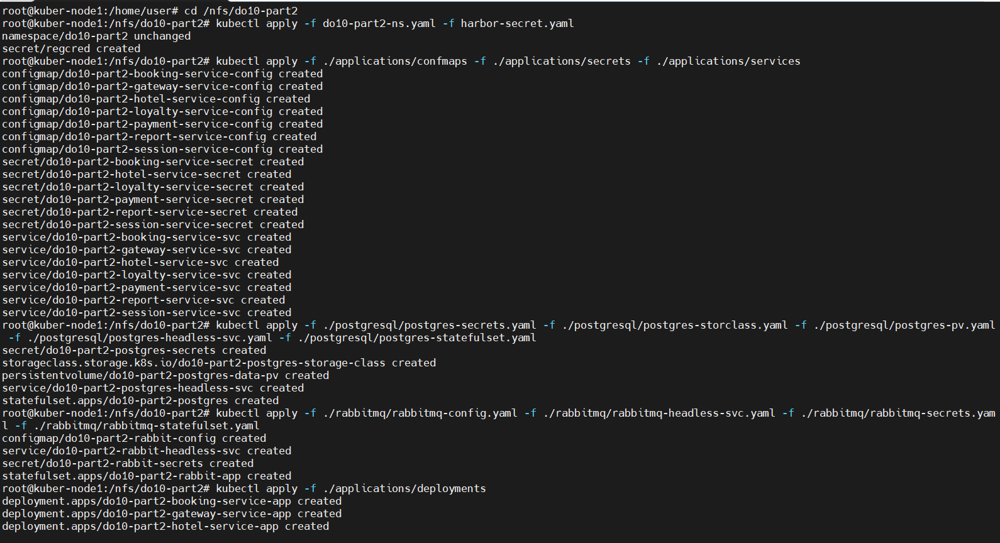

Красота.

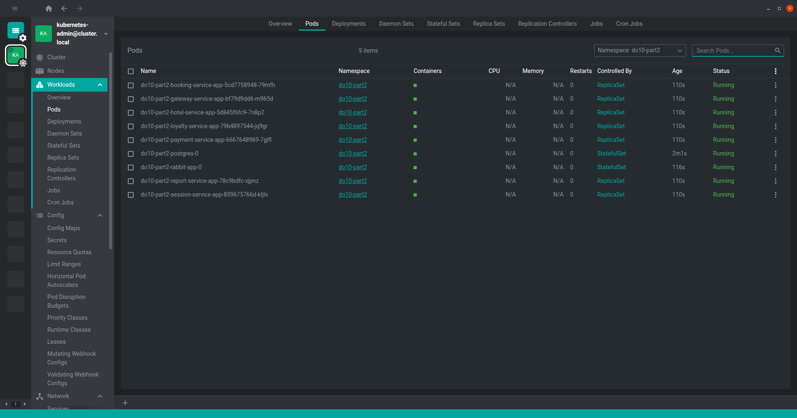

Так тоже красота. Но обратите внимание на то, что пара сервисов у нас имеют тип nodePort. Енто для того, чтоб можно было к ним обратиться.\
Попробуем постмановские тесты:

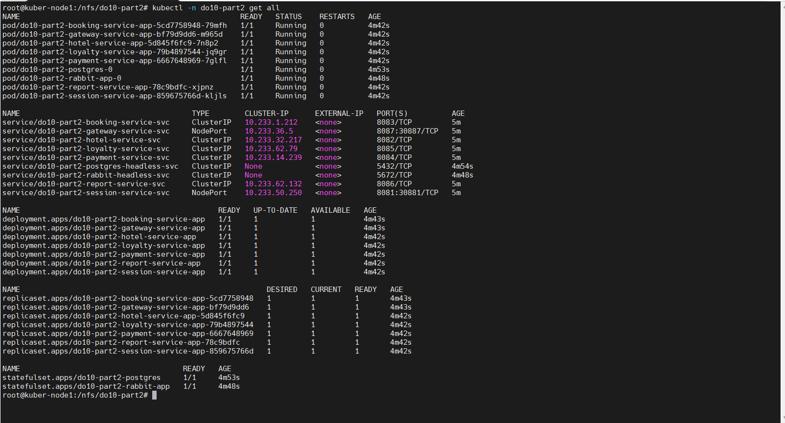

Хочу заметить еще одну вещь. Нода кластера 1 имеет адрес 172.16.20.31, нода 2 - 172.16.20.32, нода 3 - 172.16.20.33.\
А обращаемся мы к 172.16.20.30.

Такую штуку нам позволяет провернуть keepalived. Крайне полезный сервис.

### Ingress. Выходим в мир

Мы получаем к проекту доступ по IP адресу, что не очень удобно. Но, поскольку мы используем http запросы, мы можем привязать DNS имя и обращаться к ентому безобразию в более удобной форме.

Тут мы познакомимся с еще одной сущностью - ingress controller. По сути - енто прокси агент, который слушает хттп порты и отправляет на нужный сервис.

Есть у кубера дефолтный контроллер, но чуть ли не все приличные компании написали свои под разные прокси серверы.

Из вполне логичных - ingress от nginx. Но я использую contour.

Устанавливается он чрезвычайно сложно. Командой 
```
kubectl apply -f https://projectcontour.io/quickstart/contour.yaml
```

Или через Helm:
```
helm repo add contour https://projectcontour.github.io/helm-charts/
helm install my-release contour/contour --namespace projectcontour --create-namespace
```

Вообще, один хороший человек adv4000 (можно найти на гитхабе) собрал некоторую информацию на разных ингресс контроллерах. Файл я тоже приложу (Kubernetes Ingress Controllers.xlsx).

Возьмем локальный ДНС сервер и зададим там новую А запись do10.mcshine.ru и укажем наш кластер как конечную точку:

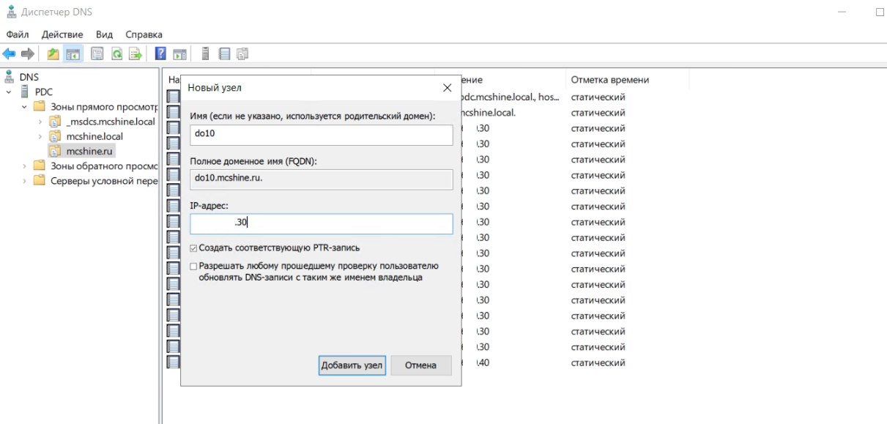

Напишем сам ингресс контроллер:
```
apiVersion: networking.k8s.io/v1
kind: Ingress
metadata:
  name: do10-part2-ingress-1
  namespace: do10-part2
spec:
  //Указываем необходимый контроллер
  ingressClassName: contour
  rules:
    //Укажем имя, которое мы прицепили выше
    - host: do10.mcshine.ru
      //Поскольку ингресс контроллер слушает только 80й и 443й порты, 
      //то на разные сервисы будет отправлять путь в запросе
      http:
        paths:
        - path: /
          pathType: Prefix
          backend:
            service:
              //Перенаправляем на сервис гейтвея
              name: do10-part2-gateway-service-svc
              port:
                //Порт пода
                number: 8087
        - path: /api/v1/auth/authorize
          pathType: Prefix
          backend:
            service:
              //Перенаправление на сервис авторизации
              name: do10-part2-session-service-svc
              port:
                //Порт пода
                number: 8081
```

Тут видно, что проброс портов (nodePort) нам больше не нужен. Наружу торчит порт контроллера (80), а сам он нормально видит сервисы внутри неймспейса.

Постман перепишем на 80й порт do10.mcshine.ru:

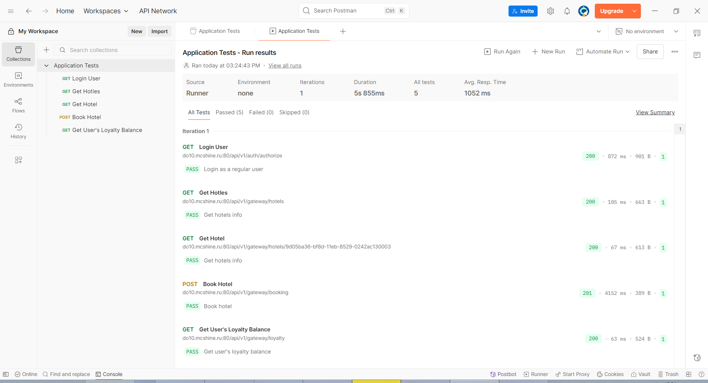

И вот вроде бы всё хорошо.

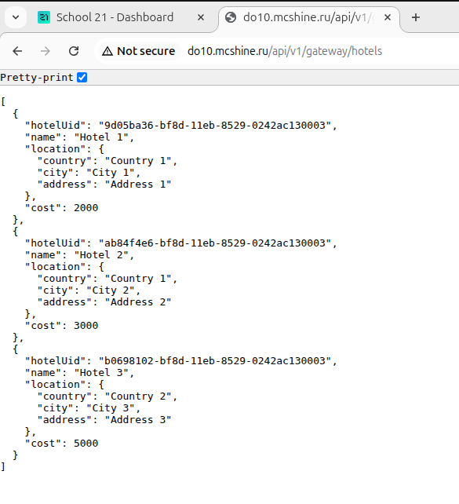

Одно плохо - хттп. В наш век, когда космические корабли бороздят большой театр, имеет больше смысла использовать хттпс.

Добавим одну штуку, которая называется cert-manager. С её попощью мы можем получить валидный сертификат letsencrypt (да хранят боги ентих добрых людей!).

Ставится оно, как обычно, сложно:
```
kubectl apply -f https://github.com/cert-manager/cert-manager/releases/download/v1.10.1/cert-manager.crds.yaml

или

helm repo add jetstack https://charts.jetstack.io
helm install cert-manager jetstack/cert-manager --namespace cert-manager \
  --create-namespace --version v1.10.0 \
  --set global.leaderElection.namespace=cert-manager
```

Еще надо ClusterIssuer прилепить:
```
apiVersion: cert-manager.io/v1
kind: ClusterIssuer
metadata:
  name: letsencrypt-prod
spec:
  acme:
    email: (ваш имайл)
    privateKeySecretRef:
      name: letsencrypt-prod
    server: https://acme-v02.api.letsencrypt.org/directory
    solvers:
    - http01:
        ingress:
          class: contour
```

Теперь можно получать сертификаты. Оно либо автоматически енто делает, либо при помощи размещения на ДНС регистратора специальной записи.\
Но поскольку мы специально настроили всё так, чтоб автоматически и делало, то пусть так и делает.

Создал ДНС запись do10-part2.mcshine.ru и вот под нее и перепишем наш ингресс:
```
apiVersion: networking.k8s.io/v1
kind: Ingress
metadata:
  name: do10-part2-ingress-1
  namespace: do10-part2
  annotations:
    //По сути, вот такой аннотацией мы и просим cert-manager запросить сертификат
    cert-manager.io/cluster-issuer: letsencrypt-prod
    ingress.kubernetes.io/force-ssl-redirect: "true"
    kubernetes.io/tls-acme: "true"
spec:
  tls:
    //cert-manager схоронит полученный сертификат для указанного домена
    //в указанный секрет
    - secretName: do10-part2-tls
      hosts:
        - do10-part2.mcshine.ru
  ingressClassName: contour
  rules:
    - host: do10-part2.mcshine.ru
      http:
        paths:
        - path: /api/v1/gateway
          pathType: Prefix
          backend:
            service:
              name: do10-part2-gateway-service-svc
              port:
                number: 8087
        - path: /api/v1/auth
          pathType: Prefix
          backend:
            service:
              name: do10-part2-session-service-svc
              port:
                number: 8081
```

Теперь применим его, и вот, поздравляю, у вас хттпс:

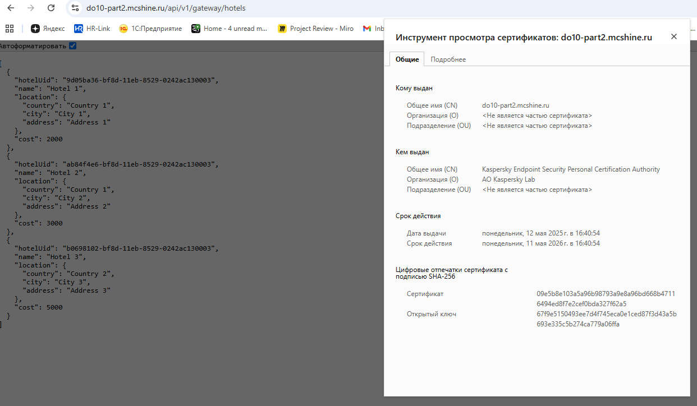

Постмановские тесты:

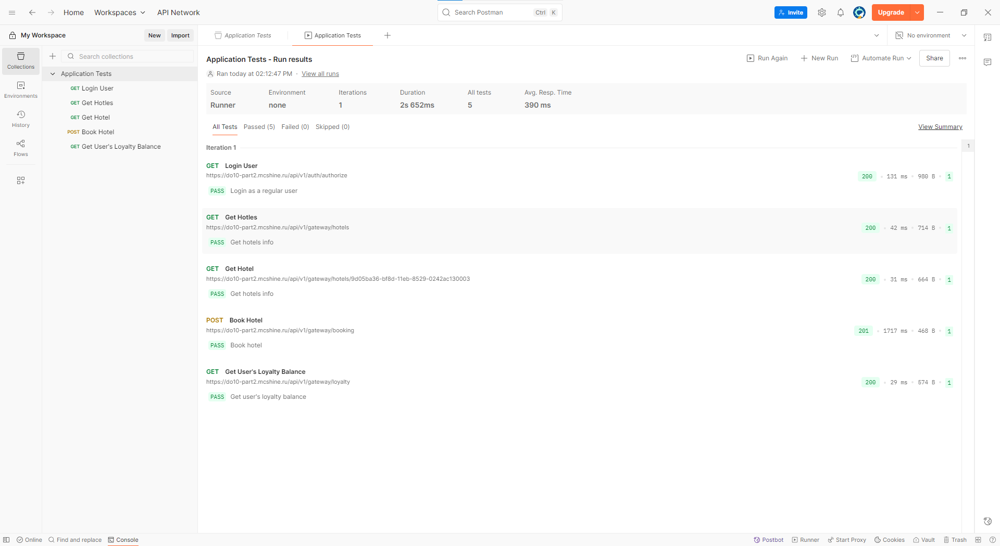

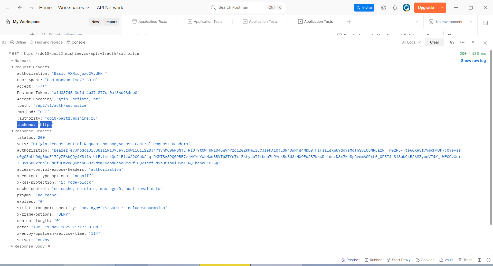

### Prometheus 

Для выполнения задания, как я понимаю, будет достаточно только установки оператора. Енто не сложно. Но, если покопаться на гите хелм паках prometheus community, то можно откопать интересную вещь - kube-prometheus-stack. Заточенный под кубер стек мониторинга.

Сделаем гит клон https://github.com/prometheus-community/helm-charts.git

Перейдем в kube-prometheus-stack и установим в неймспейс monitoring, но с некоторыми оговорками:

```
helm install prometheus prometheus/kube-prometheus-stack --namespace monitoring --create-namespace \
--set prometheusOperator.admissionWebhooks.enabled=false,prometheusOperator.tls.enabled=false
```

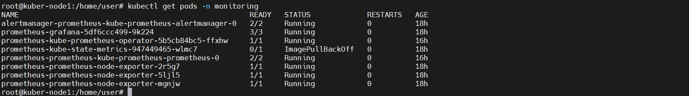

Как видим, оно ставит еще пачку вещей.

И всё бы ничего, но как быть, если мы захотим в прометей загрузить запрос на съем метрик с нужных нам подов? Файл конфига мы ему не передаем, пытаться писать в нем бесполезно, да и муторно будет.

Тут на сцену выходит очень странная, но одновременно с ентим классная штука - Custom Resoures Definitions

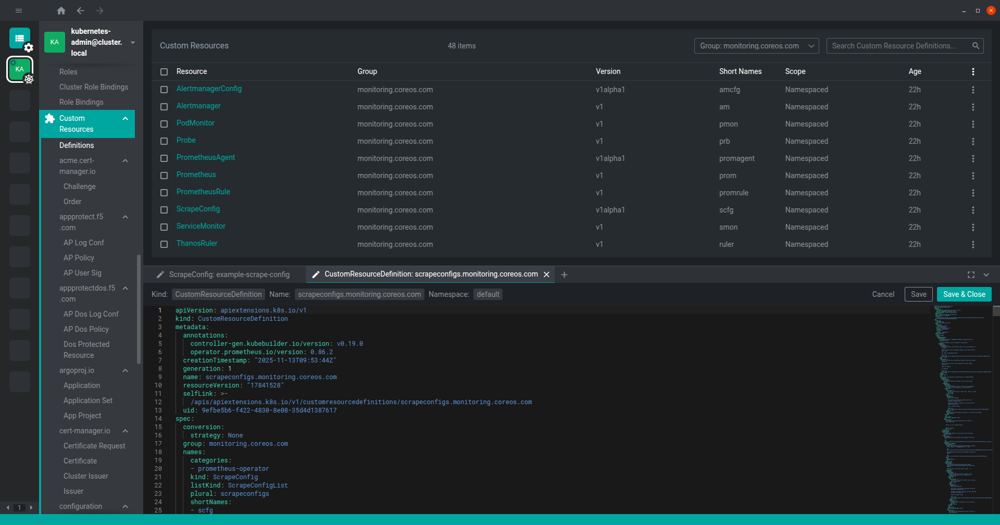

Как видно по картинке, ребята написали скрипт, который, по сути, вводит в систему еще несколько сущностей (как поды, деплойменты и прочее). Скрипт разбирает манефест, в котором "kind" указывает на сущность скрипта и делает из него куберовскую сущность, доступную из других сущностей.

В нашем случае, нам надо создать сущности типа ScrapeConfig, указать нужные параметры и лейблы, а pod config-reloader сам найдет и закинет Прометею в конфиг:
```
//Смотрим поставщика сущностей и версию API в Custom Resoures Definitions
apiVersion: monitoring.coreos.com/v1alpha1
//Сама сущность
kind: ScrapeConfig
metadata:
  //Название
  name: example-scrape-config
  //Неймспейс, где располагается Прометей
  namespace: monitoring
  labels:
    //Метки, которые шерстит config-reloader
    app: kube-prometheus-stack
    app.kubernetes.io/instance: prometheus
    app.kubernetes.io/part-of: kube-prometheus-stack
    release: prometheus
spec:
  //Название джобы в Прометее
  jobName: test-services
  //Раньше мы использовали dockerswarm_sd_configs, а тут куберовское
  //Ну, в сущности, описание стандартное
  kubernetesSDConfigs:
  - role: Endpoints
    namespaces:
      names:
      - do10-part2
  metricsPath: /actuator/prometheus
  relabelings:
  - sourceLabels: ["job"]
    targetLabel: __tmp_prometheus_job_name
```

Вот тут официальная инфа: https://prometheus-operator.dev/docs/developer/scrapeconfig/

Тут чуть поудобнее именно про спецификации ScrapeConfig: https://deckhouse.ru/modules/operator-prometheus/cr.html#scrapeconfig

Ну и тут: https://deepwiki.com/prometheus-operator/prometheus-operator/2.1-custom-resource-definitions#scrapeconfig

Вот так оно управляется:

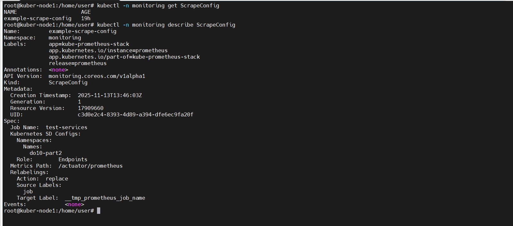

Вот так после перезапуска config-reloader

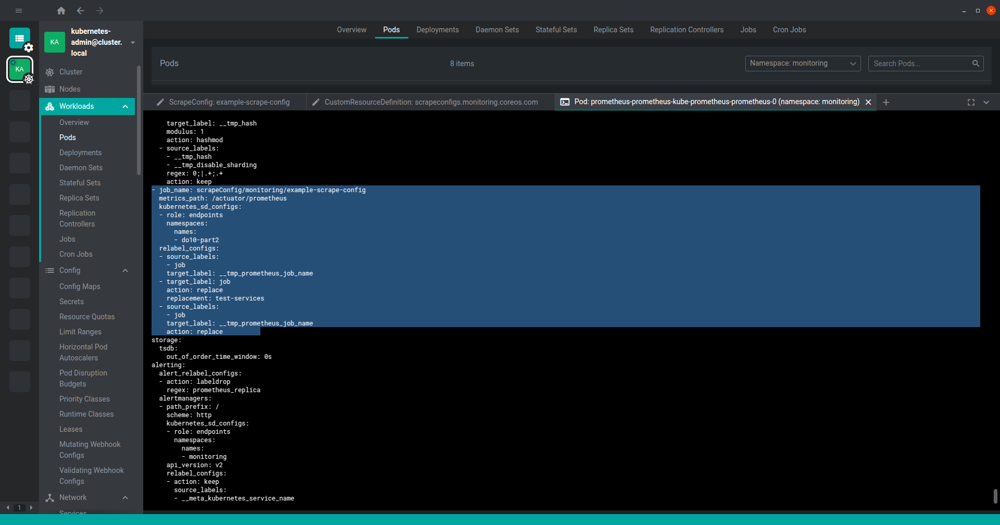

Вот так оно в прометее:

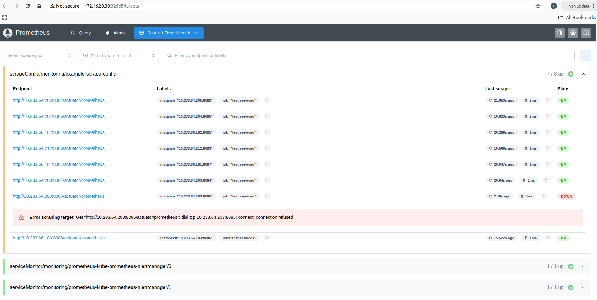

И вот наши метрики, которые мы писали ранее:

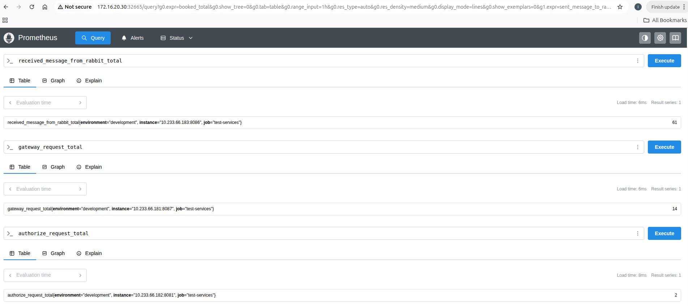